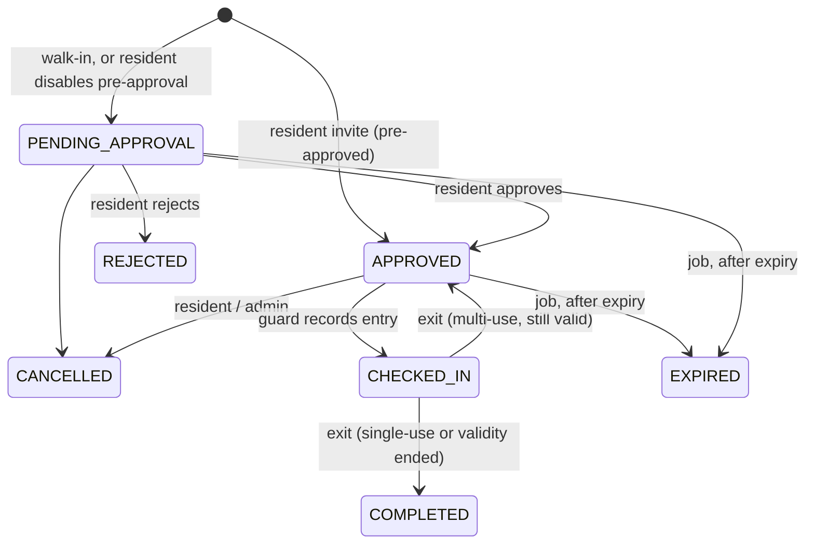

# Architecture

## Goals that shaped the design

1. **Business rules exist once.** The same authorization, validation and state machine must run locally and in AWS.
2. **Serverless and pay-per-use.** Nothing runs when nobody is at the gate.
3. **Tokens never touch browser JavaScript.**
4. **Correct under concurrency.** Two guards scanning one pass must not both admit the visitor.
5. **Explicit modes.** A misconfigured production deployment fails; it never quietly serves demo data.

## Layers

```
Browser (React)  ──fetch──►  Next.js route handlers (BFF)
                                 │  /api/auth/*  sign-in flows, cookie session
                                 │  /api/v1/*    token refresh + forward
                                 ▼
                     ┌────────── handleApiRequest() ──────────┐   src/server/api
                     │ authenticate → resolve tenant → authorize │
                     │ → rate limit → validate (Zod) → dispatch   │
                     └───────────────────┬───────────────────────┘
                                         ▼
                                  Services (src/server/services)
                     invitations · gate · users · property · announcements
                     notifications · audit · analytics · jobs
                                         ▼
                              Repositories (src/server/repositories)
                                         ▼
                         Table port (src/server/db/table.ts)
                       MemoryTable (demo)   |   DynamoTable (AWS)
```

Side effects that differ by mode sit behind ports in `src/server/ports.ts`:

| Port | LOCAL_DEMO adapter | AWS_PRODUCTION adapter |
| --- | --- | --- |
| `Table` | `MemoryTable` (DynamoDB semantics in-process, JSON persistence) | `DynamoTable` (AWS SDK v3 document client) |
| `IdentityAdmin` | `DemoIdentityAdmin` (credentials in the local table) | `CognitoIdentityAdmin` |
| `Notifier` | `DemoNotifier` (writes to a simulated outbox) | `SnsNotifier` |
| `FileStorage` | `DemoFileStorage` (HMAC-signed local upload URL) | `S3FileStorage` (presigned PUT) |
| Secrets | built-in dev-only values | SSM SecureStrings |
| `AuthGateway` / `TokenVerifier` | `DemoAuthGateway` / HS256 tokens shaped like Cognito access tokens | `CognitoAuthGateway` / `aws-jwt-verify` |

`src/server/runtime.ts` is the composition root. It builds exactly one runtime per process and **throws** if `AWS_PRODUCTION` settings or secrets are missing.

## Request flow (production)

1. The browser calls `/api/v1/invitations` on the web tier. Cookies are `httpOnly`, `SameSite=Lax`, `Secure`.
2. The BFF refreshes the Cognito access token if it expires within 60 s, rejects cross-site state-changing requests, then forwards to `API_BASE_URL/v1/invitations` with `Authorization: Bearer`.
3. API Gateway's JWT authorizer checks the Cognito signature, issuer and client.
4. The core Lambda calls `handleApiRequest`, which **verifies the token again**, loads the user by `sub` (this is where the tenant comes from), requires the Cognito group and stored role to agree, checks route access and per-user rate limits, validates the body, and calls the service.
5. Services enforce object-level authorization (residents see only their apartment) and write through conditional transactions.

Each API Lambda has `ROUTE_PREFIXES` so it serves only its slice (`core`, `security`, `admin`) and its IAM role grants only what that slice needs — e.g. only the admin function can call Cognito admin APIs, only the security function can sign S3 uploads.

## Invitation state machine



`src/shared/pass-policy.ts` decides whether a pass may be used right now (pure function, shared with the gate UI). Writes re-check it and are guarded by `version`, so a stale screen or a concurrent scan cannot bypass it.

## Concurrency

Every transition is `Put(item, condition: version = expected)` inside a DynamoDB transaction together with the visit event. If two guards submit entry for the same pass, one transaction commits; the other fails the condition, re-reads, sees `CHECKED_IN` and returns `409 DUPLICATE_ENTRY`. Integration tests fire five simultaneous entries and assert exactly one succeeds.

## Scheduled work

EventBridge invokes `src/lambda/jobs.ts`:

| Job | Schedule | Idempotency |
| --- | --- | --- |
| `expire-invitations` | 15 min | conditional transition; already-expired records are not selected |
| `flag-overdue` | 15 min | sets `overdue=true` once; notifications use dedupe keys. **Never records an exit.** |
| `reminders` | 15 min | dedupe key per invitation |
| `daily-summary` | 6 h | overwrites a deterministic key (yesterday and today) |
| `cleanup` | daily | closes self-registrations unreviewed for 30 days |

Notifications, dedupe markers and QR lookup items expire through DynamoDB TTL.

## Overdue policy

A visitor still inside 60 minutes (configurable) after their expected departure is flagged *Overdue* on the guard and admin boards and the apartment's residents and on-duty guards are notified. GateKeeper never infers that someone left — exits are only recorded by a guard. This avoids false "visitor left" records, which would be worse for safety than a stale flag.

## Frontend

- Route groups per role; each role layout renders `AppShell`, which reads `/api/v1/me` and redirects users into their own area. This is UX only — the API enforces access independently.
- `src/proxy.ts` (Next 16's renamed middleware) redirects requests without a session cookie to `/login`.
- TanStack Query handles caching and polling (gate views refresh every 10–20 s). Mutations go through `useAction`, which toasts and invalidates the relevant queries.
- Forms use React Hook Form with the same Zod schemas the server uses; server field errors are mapped back onto inputs.
- Design tokens live in `src/app/globals.css`; components in `src/components/ui` follow shadcn/ui conventions on Radix primitives. Chart colours were validated for colour-vision deficiency and contrast.

## Scaling notes

- Tenant partitions (`C#{id}`, `C#{id}#EVENTS`) suit communities of thousands of units. For very busy sites, shard the event partition by month.
- Announcement fan-out and summary computation are synchronous today; move to SNS→SQS workers if a single community exceeds ~10k users.
- Rate limiting in the router is per instance; API Gateway stage throttling is the fleet-wide control.
