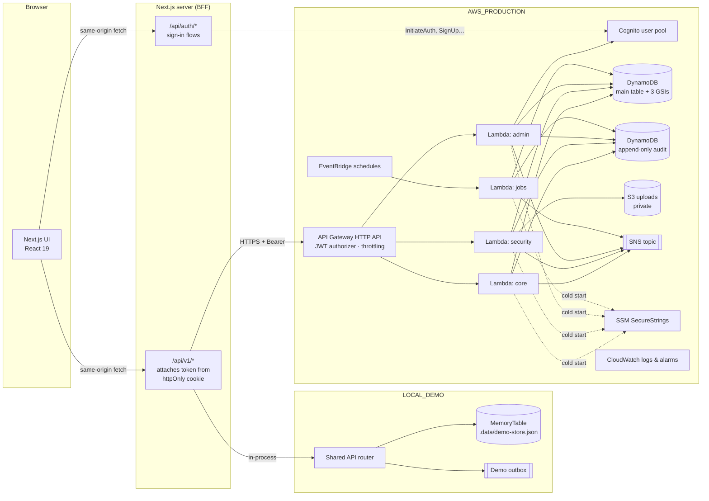

# GateKeeper

**Cloud-based visitor management for apartment communities.** Residents issue secure QR passes, security verifies them at the gate in one screen, and the association gets live occupancy, analytics and a tamper-evident audit trail — on a pay-per-use AWS serverless stack.

> **Status:** fully working in `LOCAL_DEMO` mode with automated tests (unit, integration, component, end-to-end and infrastructure). The AWS integration code and CDK stack are complete and synthesize successfully, but **have not been deployed** from this workspace (no AWS credentials were available). See [Known limitations](#18-known-limitations).

---

## Contents

1. [Product overview](#1-product-overview) · 2. [Problem](#2-problem-statement) · 3. [Features](#3-features) · 4. [Tech stack](#4-technology-stack) · 5. [Architecture](#5-architecture) · 6. [AWS services](#6-aws-services) · 7. [Database](#7-database-architecture) · 8. [Folder structure](#8-folder-structure) · 9. [Installation](#9-installation) · 10. [Environment](#10-environment-variables) · 11. [Local demo](#11-local-demo) · 12. [Demo credentials](#12-demo-credentials) · 13. [Tests](#13-running-tests) · 14. [AWS account setup](#14-aws-account-setup) · 15. [Deployment](#15-aws-deployment) · 16. [Costs](#16-estimated-aws-costs-and-free-tier-caveats) · 17. [Security](#17-security-considerations) · 18. [Limitations](#18-known-limitations) · 19. [Future work](#19-future-enhancements)

Further reading: [ARCHITECTURE.md](ARCHITECTURE.md) · [DATABASE.md](DATABASE.md) · [API_DOCUMENTATION.md](API_DOCUMENTATION.md) · [SECURITY.md](SECURITY.md) · [DEPLOYMENT.md](DEPLOYMENT.md) · [TESTING.md](TESTING.md) · [BUILD_PROGRESS.md](BUILD_PROGRESS.md)

---

## 1. Product overview

GateKeeper has three role-specific applications on one platform:

| Role | What they do |
| --- | --- |
| **Resident** | Invite visitors and share a QR pass, approve or reject walk-ins, see who is inside, browse visit history, manage profile and notification preferences. |
| **Security guard** | Scan passes with any camera (or type the gate code), record entries and exits, register walk-ins with an optional photo, watch a live "currently inside" board, search the activity log. |
| **Administrator** | Manage residents, guards, buildings, blocks and units; review self-registrations; analytics; announcements; CSV reports; verify the audit chain; set gate policy. |

## 2. Problem statement

Paper registers and intercom calls leave gaps: anyone can write any name, residents learn about visitors only when the phone rings, deliveries and domestic staff are untracked, and nobody can reliably answer "who is inside right now?" or "who let them in?". GateKeeper replaces that with verifiable passes, explicit resident approval and an append-only record of every gate event.

## 3. Features

- **Secure QR passes** — 256-bit random tokens; the QR carries only `GK1.<token>`. The database stores an HMAC of the token (plus an AES-GCM-encrypted copy so the owner can re-display it). Single-use or recurring (up to 31 days). Regenerate revokes the old QR atomically.
- **Gate verification** — expired, not-yet-valid, cancelled, rejected, pending, already-used and foreign-community passes are refused with a clear reason. Every scan, success or failure, is logged.
- **Atomic entry/exit** — transitions are conditional on the record's version, so two guards scanning simultaneously cannot both admit a visitor (verified by a concurrency test).
- **Walk-ins** — security registers the visitor; residents are notified and approve or reject; optional photo upload through a signed, type- and size-bound URL.
- **Notifications** — in-app always; e-mail/SMS via Amazon SNS per user preference; dedupe keys prevent duplicates; delivery failures never fail a gate operation.
- **Scheduled jobs** — expire unused passes, flag overdue visitors (never auto-exit), daily summaries, reminders, stale-registration cleanup. All idempotent.
- **Analytics** — daily/weekly/monthly traffic, category mix, denied attempts; every chart has a table view.
- **Multi-tenant** — communities are isolated by key design; the tenant always comes from the verified identity.
- **Tamper-evident audit log** — hash-chained entries in a table app roles cannot update or delete, with the chain head anchored to S3 Object Lock every 6 hours; verifiable in one click.
- **Explicit modes** — `LOCAL_DEMO` (no AWS, clearly bannered) and `AWS_PRODUCTION` (fails loudly if misconfigured; never falls back to demo).

## 4. Technology stack

| Layer | Choice |
| --- | --- |
| Web | Next.js 16 (App Router, Turbopack), React 19, TypeScript (strict, `noUncheckedIndexedAccess`) |
| UI | Tailwind CSS 4, shadcn/ui-style components on Radix, Lucide icons, Recharts, Sonner toasts |
| Forms & data | React Hook Form + Zod 4 (shared client/server schemas), TanStack Query |
| QR | `qrcode.react` (generation), native `BarcodeDetector` with `jsQR` fallback (scanning) |
| Backend | Framework-agnostic router + services + repositories in `src/server`, served by Next route handlers (demo) and AWS Lambda (production) |
| AWS | Cognito, API Gateway (HTTP API), Lambda (Node 22, arm64), DynamoDB, S3, SNS, EventBridge, CloudWatch, SSM Parameter Store — via AWS SDK v3 |
| IaC | AWS CDK v2 (TypeScript) |
| Tests | Vitest, React Testing Library, Playwright, `aws-sdk-client-mock`, CDK assertions |

## 5. Architecture



The key decision: **one router, two hosts.** `src/server/api/router.ts` performs authentication, tenant resolution, role checks, validation and dispatch. In demo it is called in-process; in production each Lambda calls the same function with a route-prefix allow-list. Details in [ARCHITECTURE.md](ARCHITECTURE.md).

## 6. AWS services

| Service | Used for |
| --- | --- |
| **Cognito** | Sign-up with e-mail verification, sign-in, forced password change for invited users, password reset, refresh tokens, `RESIDENT`/`SECURITY`/`ADMIN` groups. Pre-sign-up and post-confirmation triggers validate the community code and create the pending profile. |
| **API Gateway (HTTP API)** | `/v1/*` routes with a Cognito JWT authorizer, CORS restricted to the app origin, stage throttling (50 rps / burst 100), JSON access logs. |
| **Lambda** | Three API functions split by route prefix (least privilege), one jobs function, two Cognito triggers. |
| **DynamoDB** | On-demand single table (3 GSIs, TTL) plus a separate append-only audit table. Encrypted at rest; PITR in prod. |
| **S3** | Private bucket for gate photos; presigned PUTs bound to content type and size; TLS enforced; 90-day lifecycle. |
| **SNS** | Notification topic with per-user filter policies for e-mail; optional transactional SMS. |
| **EventBridge** | Five scheduled rules invoking the jobs function. |
| **CloudWatch** | 30-day log retention, API 5xx and Lambda error alarms to an alarm topic. |
| **SSM Parameter Store** | QR pepper and encryption key as SecureStrings (standard tier). |

## 7. Database architecture

A single DynamoDB table holds every tenant entity, keyed so that every query is scoped to `C#{communityId}`; three overloaded GSIs serve apartment history, status queues and community-wide date ranges. Conditional writes enforce uniqueness (e-mails, unit numbers, gate codes, QR hashes) and gate concurrency. Audit entries go to a second table with append-only IAM. See [DATABASE.md](DATABASE.md) for the full key schema and access-pattern matrix.

## 8. Folder structure

```
GateKeeper/
├── src/
│   ├── app/                      Next.js routes
│   │   ├── page.tsx              Marketing site
│   │   ├── (auth)/               login, register, forgot-password, reset-password
│   │   ├── resident/ security/ admin/   Role dashboards (layout enforces role)
│   │   ├── pass/                 Visitor-facing pass (token in URL fragment only)
│   │   ├── pending/              Awaiting-approval screen
│   │   └── api/
│   │       ├── auth/[action]/    Sign-in flows → Cognito / demo gateway, httpOnly cookies
│   │       ├── v1/[...path]/     BFF: token refresh + shared router (demo) or API Gateway (prod)
│   │       ├── demo-upload/      Demo stand-in for S3 presigned PUT
│   │       └── demo/reset/       Demo-only reset (E2E)
│   ├── components/               ui/ (design system), shared/, layout/, marketing/
│   ├── features/                 auth, invitations, resident, security, admin
│   ├── lib/                      API client, hooks, formatters
│   ├── shared/                   Domain vocabulary, Zod schemas, types, pass policy, time helpers
│   ├── server/
│   │   ├── api/                  Router, route table, HTTP helpers, rate limiter
│   │   ├── auth/                 Actor & authorization, token verifiers, auth gateways
│   │   ├── adapters/             demo.ts (local), aws.ts (Cognito, SNS, S3, SSM)
│   │   ├── db/                   Storage port, MemoryTable, DynamoTable, key schema
│   │   ├── repositories/         Typed data access
│   │   ├── services/             Business logic (invitations, gate, users, property, analytics, jobs…)
│   │   ├── demo/seed.ts          Demo data (two communities, ~4 months of history)
│   │   ├── runtime.ts            Composition root per mode
│   │   └── bff.ts                Cookie/session helpers for the web tier
│   ├── lambda/                   api.ts, jobs.ts, cognito-triggers.ts
│   └── proxy.ts                  Route guard (Next 16 "proxy", formerly middleware)
├── infrastructure/               AWS CDK app (bin/, lib/, test/, cdk.json)
├── scripts/                      create-secrets.sh, bootstrap-community.ts
├── tests/                        unit/, integration/, frontend/, e2e/, helpers/
└── *.md                          Documentation
```

## 9. Installation

Requirements: **Node.js 22 LTS recommended** (20.9+ works, but Node 20 is end-of-life) and npm.

```bash
npm install
npx playwright install chromium   # only needed for end-to-end tests
```

## 10. Environment variables

Copy `.env.example` to `.env.local`. The only variable needed locally is `GATEKEEPER_MODE=LOCAL_DEMO` (it is also the implicit default in `next dev`). Every variable is documented in [.env.example](.env.example); production settings are covered in [DEPLOYMENT.md](DEPLOYMENT.md).

## 11. Local demo

```bash
npm run dev:demo          # http://localhost:3000
```

On first start GateKeeper seeds two communities ("Lakeview Residences" and "Harbor Point Towers", the latter to demonstrate tenant isolation), buildings, apartments, users, ~120 days of realistic history and a live "today" (visitors inside, one overdue, one walk-in waiting for approval). Data persists in `.data/demo-store.json`; `npm run demo:reset` clears it and the next start re-seeds.

A dark banner on every page marks the demo. In demo mode:

- e-mails/SMS are written to a **simulated outbox** (Admin → Settings → Demo tools) instead of being sent;
- verification and reset codes are shown on screen, labelled as simulated;
- admin-created accounts show their temporary password once (Cognito e-mails it in production);
- **Admin → Settings → Run scheduled jobs now** triggers what EventBridge runs in AWS.

Try the full journey: sign in as the resident, invite a visitor, copy the pass, sign in as security in another browser, paste the pass or type the gate code on **Scan pass**, record entry, then exit from **Currently inside**.

## 12. Demo credentials

Development only — these accounts exist only in the local seed and are never created in AWS.

| Role | E-mail | Password |
| --- | --- | --- |
| Administrator | `admin@gatekeeper.demo` | `GateKeeper@2026` |
| Security guard | `security@gatekeeper.demo` | `GateKeeper@2026` |
| Resident (Tower A · A-1204) | `resident@gatekeeper.demo` | `GateKeeper@2026` |
| Other tenant (isolation checks) | `admin@harborpoint.demo`, `security@harborpoint.demo`, `resident@harborpoint.demo` | `GateKeeper@2026` |

Community code for self-registration: **`LAKE2026`**.

## 13. Running tests

```bash
npm test                  # Vitest: server unit + integration, frontend components
npm run test:e2e          # Playwright against a production build (port 3200, isolated data)
npm run lint && npm run typecheck
cd infrastructure && npm install && npm test   # CDK assertions
```

Latest recorded results are in [TESTING.md](TESTING.md).

## 14. AWS account setup

1. An AWS account and an IAM principal allowed to deploy CloudFormation/CDK (use a dedicated deploy role, not root).
2. AWS CLI v2 configured (`aws configure` or SSO) and a region (e.g. `ap-south-1`).
3. `npx cdk bootstrap aws://ACCOUNT/REGION` once per account/region.
4. SES/SNS e-mail: subscribers confirm by e-mail. For SMS, review SNS sandbox and country registration rules (India requires DLT sender registration).

## 15. AWS deployment

Nothing is deployed automatically. In short:

```bash
cd infrastructure && npm install
npx cdk synth -c stage=dev -c appOrigin=https://your-web-host        # review
npx cdk diff  -c stage=dev -c appOrigin=https://your-web-host
npx cdk deploy -c stage=dev -c appOrigin=https://your-web-host       # operator approval
STAGE=dev ./scripts/create-secrets.sh                                 # SSM SecureStrings
npx tsx scripts/bootstrap-community.ts --name ... --admin-email ...   # first community + admin
```

Then host the Next.js web tier (AWS Amplify Hosting with SSR, or any Node host) with the CDK outputs as environment variables. Full steps, the resource list and teardown instructions: [DEPLOYMENT.md](DEPLOYMENT.md).

## 16. Estimated AWS costs and Free Tier caveats

GateKeeper uses no always-on compute (no EC2, RDS, NAT Gateway or load balancer), so idle cost is close to zero. **It is not guaranteed to be free.** Indicative usage for a ~400-unit community with ~150 visits/day (≈ 300k API requests and ≈ 1M DynamoDB request units per month):

| Service | Pricing model (check current AWS pricing for your region) | Expected |
| --- | --- | --- |
| Lambda | 1M requests + 400k GB-s/month always-free | within free allowance |
| API Gateway HTTP API | ~$1.00 per million requests | ≈ $0.30 |
| DynamoDB on-demand | per request unit; 25 GB storage free | ≈ $0.50–1.50 |
| Cognito | Lite/Essentials tiers free up to 10,000 MAU | $0 at this scale |
| S3 | storage + requests | cents |
| SNS e-mail | 1,000 free/month, then ~$2 per 100k | ≈ $0 |
| **SNS SMS** | **per message, varies by country; registration may be required** | **off by default — can dominate cost** |
| CloudWatch | 5 GB logs and 10 alarms free; 4 alarms used | ≈ $0–1 |
| EventBridge scheduled rules, SSM standard params, AWS-managed KMS keys | no charge for these uses (KMS API calls minimal) | ≈ $0 |
| DynamoDB PITR (prod stage only) | per GB-month | small |
| Web hosting (Amplify SSR or other) | build minutes, compute, data transfer | depends on host |

AWS changed its Free Tier for new accounts in July 2025 (credit-based free plan); older accounts keep the legacy 12-month offers. Set an **AWS Budget alert** before deploying. More in [DEPLOYMENT.md](DEPLOYMENT.md#cost-controls).

## 17. Security considerations

Cognito JWT verification in both API Gateway and Lambda; role from the Cognito group **and** the stored record must agree; tenant taken only from the verified identity; IDOR protection returns 404 for other tenants/apartments; Zod validation on every input; hashed QR tokens; httpOnly SameSite cookies + origin checks; CSP and security headers; rate limiting; least-privilege IAM per Lambda; append-only, hash-chained audit trail; no PII or tokens in logs. Full threat model: [SECURITY.md](SECURITY.md).

## 18. Known limitations

- See **[PRODUCTION_READINESS_AUDIT.md](PRODUCTION_READINESS_AUDIT.md)** for the full security/readiness review, open items and cost model.
- **Not deployed.** The AWS path is implemented, unit-tested with mocks and synthesizes, but has not been exercised against a live account from this workspace. Expect to validate Cognito trigger wiring, SNS e-mail confirmation and the web-tier hosting on first deploy.
- Rate limiting inside the app is per-instance memory; fleet-wide limits come from API Gateway throttling.
- Visitor search uses DynamoDB `contains` filters over bounded key ranges — fine for a community, not a full-text index.
- Announcements fan out notifications synchronously; very large communities should move fan-out to SNS/SQS.
- Analytics read pre-computed daily summaries; the summary job runs every 6 hours, so earlier days can lag by up to that interval (today is always live).
- Gate photos are stored privately but not yet displayed in the UI (no presigned GET flow).
- The demo store is a single JSON file — single-process only, not for production.

## 19. Future enhancements

Push notifications (web push / mobile app), visitor pre-registration links that let guests fill their own details, vehicle number-plate recognition, recurring schedules for domestic staff, multi-gate support with per-gate guards, offline-capable guard app, SQS-backed notification fan-out, OpenSearch for full-text search, per-community branding, and SSO for property-management companies.
